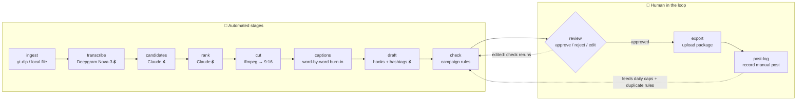

<div align="center">

# 🎬 Montaj

**Turn long videos into reviewed, campaign-ready vertical clips, from one command line.**


[](LICENSE)

[Features](#-features) · [Pipeline](#-pipeline) · [Quick start](#-quick-start) · [Docker Desktop](#windows-pilot-with-docker-desktop) · [Commands](#-commands) · [Safety rules](#-rules-that-never-change) · [Roadmap](#-roadmap)

</div>

---

## What is Montaj?

Montaj takes a long video from a **permitted source**, finds its best moments, cuts them into vertical 9:16 clips with word-by-word captions, drafts hooks and hashtags, checks every clip against the campaign rules, and packages the approved ones for manual posting.

It is built for **one operator** running content-rewards campaigns across three niche accounts (business, health, games). Speed and passing campaign rules matter more than software features.

> **Nothing is ever posted automatically.** A person reviews every single clip before it goes anywhere. Montaj is a pipeline with a human gate, not an auto-poster.

## ✨ Features

- **Permission-first ingest** — the pipeline refuses to touch a source unless it is explicitly marked allowed, with a recorded permission basis.
- **AI moment finding** — Deepgram Nova-3 transcription with word-level timestamps (Arabic dialects included), then Claude proposes and ranks the strongest moments.
- **Vertical clips, captioned** — `ffmpeg` reframes to 9:16 and burns in word-by-word captions, with an Arabic font bundled.
- **Hooks that follow the transcript** — two hook options, a caption, and hashtags per clip, written in the target account's style.
- **Campaign compliance check** — length, banned words, required hashtags, disclosure, duplicate posts, and daily caps are checked before review, and re-checked after every edit.
- **Human review gate** — watch clips in a read-only local preview, trim, pick a hook, approve or reject. A failed check cannot be approved.
- **Cost ceilings** — per-run and per-source spending caps stop paid API calls before they overshoot. `montaj costs` shows exactly what you spent.
- **Resumable stages** — every stage persists its output and is skipped when its inputs have not changed. `run` stops at the first failure and resumes there.
- **Full audit trail** — SQLite logs every source, clip, check, approval, export, and manual post.

## 🔄 Pipeline

Each stage is its own command and can be rerun independently. The compliance check runs after drafting and again after any edit in review.



💲 = paid API call, guarded by the configured budget ceilings.

**Or just run it all:**

```bash
uv run montaj run 1 --until check
```

`run` executes the automated stages in order, skips anything already current, stops at the first failure, and resumes there on the next run. It never reviews, exports, or posts.

## 🚀 Quick start

### Requirements

- Python 3.12
- [uv](https://docs.astral.sh/uv/)
- `ffmpeg` and `ffprobe` on `PATH`
- For video URLs, `yt-dlp` `2026.10.26` on `PATH`. YouTube also needs Deno and the matching EJS solver in the yt-dlp installation. See the [server setup](docs/server.md#youtube-ingestion). Local-file ingest needs only the media tools.

### Install and set up

```bash
uv sync
cp .env.example .env   # fill in the keys, never commit .env
uv run montaj db init
uv run montaj doctor
```

Run commands as `uv run montaj ...`.

`doctor` stays offline. It checks tools, YouTube dependency discovery, key presence, the data directory, the database schema, the caption font, and free space. YouTube dependency warnings apply to URL ingestion. `doctor --online` sends one one-second silent clip to Deepgram and one one-token request to Claude, prints `OK`/`FAIL` per service, and costs under a cent.

### Configuration

| Variable | Used by | Default |
| --- | --- | --- |
| `DEEPGRAM_API_KEY` | `transcribe`, `doctor --online` | — |
| `ANTHROPIC_API_KEY` | `candidates`, `rank`, `draft`, `doctor --online` | — |
| `MONTAJ_DATA_DIR` | Where the database and media live | `data/` |
| `MONTAJ_DEEPGRAM_LANGUAGE` | Language sent to Deepgram | `en` |
| `MONTAJ_DEEPGRAM_MODEL` | Transcription model | `nova-3` |
| `MONTAJ_CLAUDE_MODEL` | Claude model | `claude-sonnet-5-5` |
| `MONTAJ_MAX_COST_PER_RUN_USD` | Spending ceiling for one run | `0.50` |
| `MONTAJ_MAX_COST_PER_SOURCE_USD` | Spending ceiling for one source | `2.00` |
| `MONTAJ_MAX_SOURCE_MINUTES` | Longest source accepted at ingest | `120` |
| `MONTAJ_MAX_SOURCE_MB` | Largest source accepted at ingest | `1024` |
| `MONTAJ_BACKUP_KEEP` | Newest database copies `backup` keeps | `7` |
| `MONTAJ_MIN_FREE_MB` | Free-space warning and download floor | `1024` |
| `MONTAJ_CLEAN_OLDER_THAN_DAYS` | Default age for `clean` | `14` |

Paid stages stop **before** the request when the next call would pass either cost ceiling. `--budget 1.00` overrides both ceilings for that command.

### Windows pilot with Docker Desktop

Install and start [Docker Desktop for Windows](https://docs.docker.com/desktop/setup/install/windows-install/) with the WSL 2 backend and Linux containers. Open PowerShell in the Montaj checkout. `docker version` should show a Linux server, and Compose must be version 2.24 or later.

```powershell
docker compose build
docker compose run --rm montaj --help
docker compose run --rm montaj db init
```

The container runs as the non-root `montaj` user and includes pinned yt-dlp, EJS, and Deno. Rebuild the image to apply downloader dependency changes. The bind mount maps `/app/data` to `data\` in the checkout. SQLite, source videos, generated clips, preview copies, and exports survive `--rm` and image rebuilds. Compose fixes the container's `MONTAJ_DATA_DIR` to this mount. Use Linux paths such as `data/inbox/interview.mp4` in container commands.

To check offline without entering real credentials, run `doctor` with placeholder values. The command checks credential presence and the local tools, database, font, and storage. The test command clears both keys and requires FFmpeg so media tests cannot silently skip it.

```powershell
docker compose run --rm -e DEEPGRAM_API_KEY=offline -e ANTHROPIC_API_KEY=offline montaj doctor
docker compose run --rm -e DEEPGRAM_API_KEY= -e ANTHROPIC_API_KEY= -e MONTAJ_REQUIRE_FFMPEG=1 --entrypoint python montaj -m pytest -p no:cacheprovider
```

For the pilot, copy `.env.example` to `.env` if there is no `.env` already, then fill in `ANTHROPIC_API_KEY` and `DEEPGRAM_API_KEY`. Compose reads `.env` at runtime. Keep it out of Git and use `docker compose config --quiet` to validate Compose without printing the resolved configuration. Get explicit approval before running any paid call. After approval, `docker compose run --rm montaj doctor --online` sends one request to each provider under the existing smoke-test budget.

Place a permitted local video in `data\inbox\interview.mp4`, creating the `inbox` folder first. The ingest command prints the source ID for subsequent commands. Use the same ID after recreating the container.

```powershell
docker compose run --rm montaj ingest data/inbox/interview.mp4 --niche games --allowed --basis 'creator written permission'
```

After the pipeline has rendered clips, open a clip directly from `data\clips\<clip id>\final.mp4` in Windows, or export a preview page for the source. This example uses source ID `1`.

```powershell
docker compose run --rm montaj preview export 1
Invoke-Item .\data\preview\1\index.html
docker compose run --rm montaj review 1
```

The preview opens from disk and Compose publishes no ports. Review each clip in `review` before exporting it for manual posting.

Run the operations dashboard from the Windows checkout with `uv run montaj dashboard`, then open `http://127.0.0.1:8765/dashboard`. The host process reads the same `data\` directory used by Compose.

## 🛠 Commands

### Stage commands

Each command takes a source id printed by `ingest`. A finished stage is reused when its inputs have not changed.

```bash
# 1. Ingest — permission is mandatory
uv run montaj ingest C:\videos\interview.mp4 --niche games --allowed --basis "creator written permission"

# 2. Transcribe — Deepgram Nova-3 with word timestamps
uv run montaj transcribe 1 --language en

# 3. Candidates — Claude proposes moments (20–60s by default)
uv run montaj candidates 1

# 4. Rank — one Claude pass scores and keeps the top picks
uv run montaj rank 1 --top 10

# 5. Cut — ffmpeg trims each pick to vertical 9:16
uv run montaj cut 1

# 6. Captions — word-by-word burn-in (bundled Arabic font)
uv run montaj captions 1

# 7. Draft — two hooks, a caption, hashtags per clip
uv run montaj draft 1

# 8. Check — the clip against the campaign rules
uv run montaj check 1
```

- Niches are `business`, `health`, and `games`. `--campaign` takes an id from `montaj campaign list`; when that campaign sets `allowed_sources`, the path or URL must match.
- Transcription language mismatches stop before any Claude call (`en` matches `en-US`, `ar` matches `ar-EG`, `multi` accepts the detected language). `--force-language` overrides.
- `cut`, `captions`, `draft`, and `check` accept `--clip` to limit the command to one clip.
- `run` and each writing stage hold a per-source lock and refuse with the holder's name when busy; `--wait 30` waits instead.

```bash
uv run montaj costs          # estimated API spend by stage and source
```

### Preview

Read-only. It does not approve, export, or post.

```bash
uv run montaj preview serve       # http://127.0.0.1:8765/ (loopback only)
uv run montaj preview export 1    # copy renders into one folder with an index page
```

`uv run montaj dashboard` opens the read-only operations view on the same loopback server. Use it to find sources needing attention, inspect saved checkpoints, see clip statuses and estimated API costs, or open a source's clips in the preview. Refresh to read the latest saved state. Keep running stages and recording review decisions in the CLI.

On a remote server, tunnel in: `ssh -L 8765:127.0.0.1:8765 user@server`.

### Review

The approval step. It prints the render path, preview address, permission basis, transcript, both hooks, the caption, and the check result.

```bash
uv run montaj review 1
```

Keys: `a` approve · `r` reject with a reason · `1`/`2` pick a hook · `c` replace the caption · `t` trim by seconds · `u` pick the posting account · `n` skip · `q` quit.

**A failed check cannot be approved.** A warning asks for `y` and records the confirmation. Every edit re-runs the check and returns the clip to review.

### Export

Copies approved clips into a folder for manual upload. A clip is exported only when it is approved, its check is a current pass or confirmed warning, and its source is allowed with a recorded basis.

```bash
uv run montaj export --account 1
```

Each clip ships as an `mp4` plus a text file (hook, caption, hashtags), with a `manifest.csv` for the day.

### Post log

Records a post you published by hand. It does not upload or approve anything. The compliance check reads these rows for daily caps and duplicate-post rules.

```bash
uv run montaj post-log 1 --account 1 --url https://www.youtube.com/shorts/example
uv run montaj post-log list --account 1 --today
```

### Backup and clean

```bash
uv run montaj backup                       # online copy of the db, keeps newest 7
uv run montaj clean --dry-run              # shows what would be freed, deletes nothing
uv run montaj clean --older-than-days 14   # deletes stale source/raw media only
```

Long jobs, log rotation, nightly backup, and the preview SSH tunnel are in the [server runbook](docs/server.md).

## 📁 Where files go

`data/` is git-ignored.

```text
data/montaj.db                              # SQLite: sources, clips, checks, posts
data/backups/montaj-<UTC timestamp>.db
data/logs/montaj.log
data/sources/<source id>/video.mp4          # ingested source + audio + transcript
data/sources/<source id>/candidates.json
data/clips/<clip id>/raw.mp4                # uncaptioned render
data/clips/<clip id>/final.mp4              # captioned render
data/exports/<UTC date>/<account id>-<handle>/   # approved packages + manifest.csv
```

## 🛡 Rules that never change

- Only process a source marked allowed, with a short permission basis.
- A person reviews every clip before it is posted. **There is no auto-posting.**
- No proxies, fake browsers, or fingerprint tricks. Official APIs or manual posting only.
- Never commit secrets, API keys, cookies, source videos, or rendered clips.

## 🗺 Roadmap

The full build order lives in [issue #31](https://github.com/Kemetra-Labs/montaj/issues/31). Every PR must pass ruff, mypy, and pytest (CI-enforced), link its issue (`Closes #N`), contain no secrets, and never call real APIs in tests.

| Milestone | Scope | Gate |
| --- | --- | --- |
| **M1 — To ranked candidates** | setup, db, ingest, transcribe, candidates, rank | — |
| **M2 — Clips out** | cut, captions, draft, check | M1 merged and green |
| **M3 — Tracking** | review queue, export, post log, first real run (#30) | M2 merged |
| **M4 — Posting via API** | official API posting, YouTube first | week 3 checkpoint + owner approval |

Phase 2 (metrics, reporting, extra scoring signals) starts only after the first real run passes. The six-week test plan, platform posting facts, and risks are in the [architecture doc](docs/ARCHITECTURE.md).

## 📚 More

- [Architecture](docs/ARCHITECTURE.md) — decisions, data model, six-week test plan, risks
- [Pipeline contract](docs/pipeline-contract.md) — clip status, render paths, cache rules
- [Campaign rules file](docs/campaign-rules.md)
- [Server runbook](docs/server.md)
- [CLAUDE.md](CLAUDE.md) — conventions for AI-assisted development

## 📄 License

Montaj is licensed under the [Apache License 2.0](LICENSE).

Copyright 2026 Kemetra Labs.
